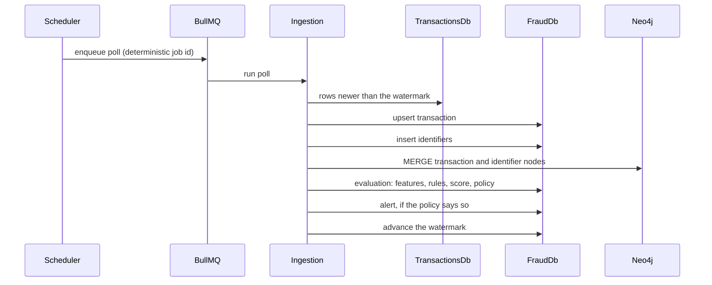

# Architecture

## Context

```mermaid
flowchart LR
    analyst([Fraud analyst])
    payments[(Payment platform<br/>TransactionsDb)]

    subgraph scamurai[Scamurai]
        frontend[Frontend<br/>Vue 3]
        bff[BFF<br/>NestJS]
        engine[Fraud engine<br/>NestJS]
        txapi[Transactions API<br/>ASP.NET Core 8]
        frauddb[(FraudDb<br/>SQL Server)]
        graph[(Identifier graph<br/>Neo4j)]
        queue[(Job queue<br/>Redis + BullMQ)]
    end

    analyst --> frontend
    frontend --> bff
    bff --> engine
    txapi -- read only --> payments
    engine -- read only --> payments
    engine --> frauddb
    engine --> graph
    engine --> queue
```

The dashboard never talks to the engine directly. Every request passes through
the BFF, which is the layer that validates input and the only one a browser
can reach. The engine and the transactions API stay internal, which is why the
Apache vhost in `infra/apache/` deliberately does not proxy them.

## How a transaction becomes an alert



The scheduler derives the job id from the source name rather than the clock,
so several engine replicas enqueueing the same minute's poll produce one job
rather than one each. That is what makes the engine horizontally scalable
without a leader election.

Scoring runs in stages, each replaceable on its own:

| Stage | Input | Output |
|---|---|---|
| Feature engine | transaction + history | named feature values |
| Rules engine | feature values + configured rules | triggered rules |
| Risk score engine | triggered rules | a score |
| Risk classification | score + configured levels | a level |
| Policy engine | level, score, severity | a decision |
| Alert engine | decision + context | an alert |

Rules, risk levels and policies live in `FraudDb`, not in code, so a threshold
changes without a deploy. Feature calculators are code, registered through a
DI token: adding one is a new class, not an edit to a switch statement.

## Why two databases

`TransactionsDb` belongs to the payment platform. Scamurai reads it and never
writes to it — enforced by the grants in `infra/database/`, not only by
convention. Everything Scamurai derives lands in `FraudDb`.

Both connections run with TypeORM's `synchronize` disabled. An ORM that
reshapes a database holding payment records is a data-loss incident waiting
for a schema drift. The numbered scripts under
`apps/fraud-engine/database/` are therefore the only source of truth, applied
by the migration runner and verified from empty datastores on every CI run.

## The identifier graph

Relational queries answer "how many cards has this device used this hour".
They do not answer "are these nine accounts the same person", because that
question is about connectivity rather than aggregation.

Nodes are identifiers — `Email`, `Phone`, `IP`, `PaymentAccount`,
`DeviceFingerprint`, `Merchant` — plus one `Transaction` node per transaction,
joined by `USED_*` relationships. A ring sharing a device and an IP behind
eight unrelated names is one connected component in the graph and eight
unremarkable rows in SQL.

Each label has a uniqueness constraint. Without one, `MERGE` is not atomic
across sessions: two workers merging the same email concurrently each create a
node, the component silently splits, and the ring stops being visible as one
thing.

## Frontend layering

Each feature module under `apps/frontend/src/modules/` is split four ways:

```
domain/          entities and value objects, no framework imports
application/     use cases, depending on repository interfaces
infrastructure/  HTTP implementations of those interfaces
presentation/    components and composables
```

Dependencies point inward. The `domain` layer does not know Vue exists, which
is what lets a use case be tested without mounting a component or stubbing
`fetch`.

## Known gaps

Tracked rather than hidden:

- **No authentication anywhere in the stack.** Every endpoint is anonymous,
  and actor identity on an alert action is self-reported from the request
  body. This is the first thing to fix after Tier 0.
- **The ingestion watermark stores only a timestamp.** Rows sharing a
  `CreatedAt` with the last row of a batch are skipped permanently. The
  synthetic data generator plants that condition on purpose.
- **Graph traversal is unbounded.** Variable-length match with no
  relationship filter and `LIMIT` applied after path enumeration.
- **No health or readiness endpoints**, so container healthchecks prove only
  that a process is serving.
